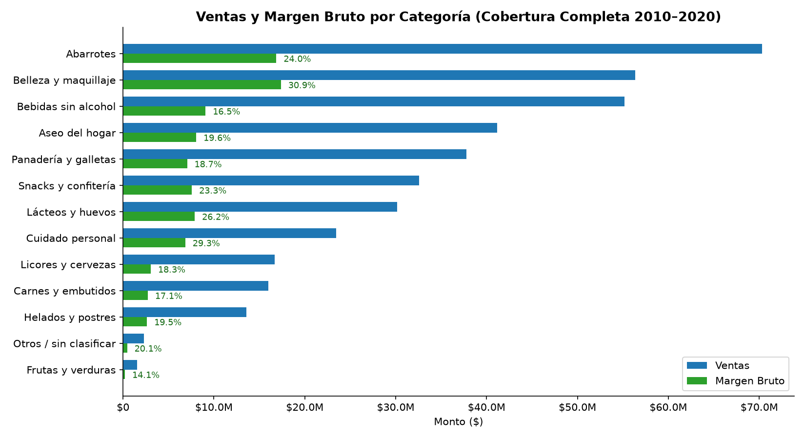
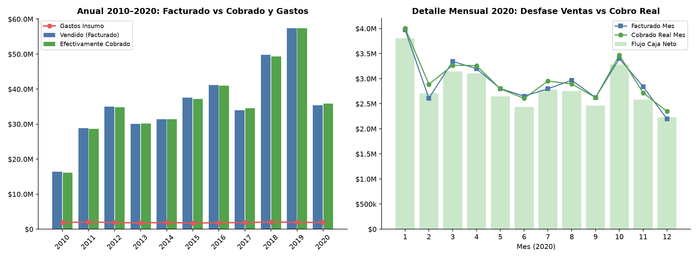
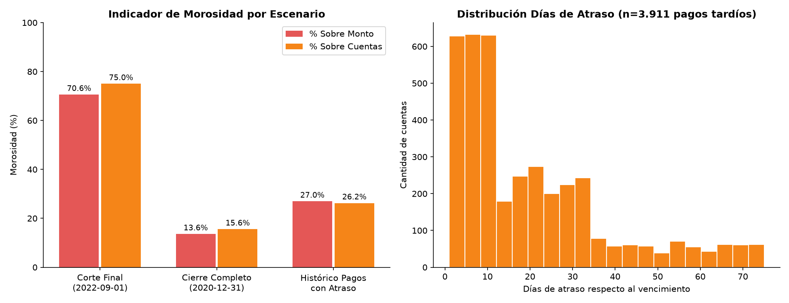
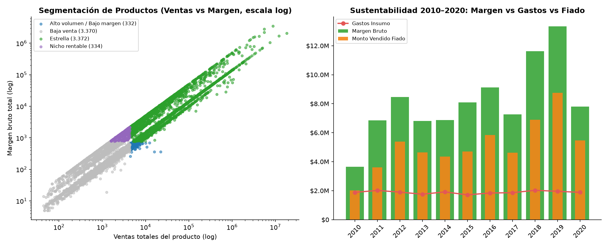

# Resumen de Análisis y Métricas — Etapa 5 (Tareas 22 a 28)

> **Herramienta analítica seleccionada:** **Power BI Desktop + Vistas SQL en PostgreSQL** (respaldado por el script reproducible [analisis_etapa5.py](analisis_etapa5.py) y [vistas_metricas_sqlite.sql](vistas_metricas_sqlite.sql) / [vistas_metricas_postgresql.sql](vistas_metricas_postgresql.sql)). La justificación comparativa y los pasos de conexión sin código se encuentran en [INSTRUCTIVO_HERRAMIENTA_BI_ETAPA_5.md](INSTRUCTIVO_HERRAMIENTA_BI_ETAPA_5.md).

---

## 1. Nota Metodológica de Integridad (Cobertura y Escala)

Para evitar conclusiones sesgadas por las particularidades heredadas de las Etapas 2 y 3 (documentadas en [auditoria_integridad_etapas_1_2_3.md](../../Etapas_1-2-3/auditoria_integridad_etapas_1_2_3.md)):

1. **Cobertura temporal (`completa` vs. `parcial`):** El período **2010–2020** (`cobertura = 'completa'`) concentra la serie anual completa (`$396.917.571` CLP en ventas, `$89.875.377` CLP en margen bruto y `$20.728.439` CLP en gastos de insumos). El período **2021–2022** (`cobertura = 'parcial'`) contiene una muestra parcial de ventas (`$6.066.628` CLP en 2021 y `$536.824` CLP en 2022), mientras que `gastos_insumo` mantiene un ritmo constante (~`$1,75M`–`$2,01M`/año). Por ello, las comparativas de desempeño, rankings y tendencias se evalúan principalmente sobre `2010–2020`, mostrando el acumulado total `2010–2022` de forma transparente.
2. **Artefacto de escala `< 15.0` de Etapa 2 (`alerta_escala_etapa2`):** `13` SKU en el subconjunto de producción (`969` líneas = `0,94%` de filas y `$3.498.017` CLP = `0,87%` de ventas) presentan saltos de escala de precio mayores a `5x` por la regla `RL-03` de Etapa 2. La vista `vw_ranking_productos` los marca con `alerta_escala_etapa2 = 1` para no distorsionar decisiones de precios.

---

## 2. Margen de Ganancia por Producto y Categoría (Tarea 22 — `vw_margen_producto_categoria`)

### Ranking de Categorías (`cobertura = 'completa'`, 2010–2020)

| Categoría | Facturas | Unidades | Ventas (CLP) | Costo (CLP) | Margen Bruto (CLP) | Margen % |
| :--- | ---: | ---: | ---: | ---: | ---: | ---: |
| Belleza y maquillaje | 10.917 | 62.887 | $56.349.106 | $38.967.989 | $17.381.117 | **30,85%** |
| Abarrotes | 17.190 | 64.773 | $70.310.257 | $53.439.073 | $16.871.184 | 24,00% |
| Bebidas sin alcohol | 7.602 | 52.154 | $55.157.288 | $46.071.478 | $9.085.810 | 16,47% |
| Aseo del hogar | 13.762 | 34.409 | $41.156.069 | $33.100.478 | $8.055.591 | 19,57% |
| Lácteos y huevos | 11.159 | 31.354 | $30.135.610 | $22.240.618 | $7.894.992 | 26,20% |
| Snacks y confitería | 9.232 | 30.760 | $32.565.702 | $24.989.107 | $7.576.595 | 23,27% |
| Panadería y galletas | 10.000 | 28.486 | $37.754.902 | $30.696.496 | $7.058.406 | 18,70% |
| Cuidado personal | 7.932 | 16.282 | $23.425.461 | $16.568.027 | $6.857.434 | **29,27%** |
| Licores y cervezas | 3.469 | 5.071 | $16.710.405 | $13.655.533 | $3.054.872 | 18,28% |
| Carnes y embutidos | 3.398 | 6.915 | $15.977.974 | $13.252.112 | $2.725.862 | 17,06% |
| Helados y postres | 3.557 | 11.625 | $13.553.316 | $10.915.727 | $2.637.589 | 19,46% |
| Otros / sin clasificar | 2.683 | 4.980 | $2.288.636 | $1.828.894 | $459.742 | 20,09% |
| Frutas y verduras | 123 | 435 | $1.532.845 | $1.316.662 | $216.183 | **14,10%** |

**Hallazgos clave:**
- **Motor de utilidad vs. motor de volumen:** `Abarrotes` lidera en facturación (`$70.310.257` CLP), pero `Belleza y maquillaje` lidera en margen neto (`$17.381.117` CLP, `30,85%`) superando por `$509.933` CLP a `Abarrotes` con `$13,96M` menos de ventas.
- **Top 3 categorías de margen:** `Belleza y maquillaje` (`30,85%`), `Cuidado personal` (`29,27%`) y `Lácteos y huevos` (`26,20%`) explican **35,75%** del margen bruto total (`$32.133.543` de `$89.875.377` CLP).
- **Categorías de margen ajustado:** `Frutas y verduras` (`14,10%`) y `Bebidas sin alcohol` (`16,47%`) operan como ganchos de tráfico/volumen con menor rentabilidad porcentual.

Archivo detallado por SKU/año: [t22_margen_producto_anual_completa.csv](resultados/t22_margen_producto_anual_completa.csv) y resumen por categoría [t22_margen_por_categoria_completa.csv](resultados/t22_margen_por_categoria_completa.csv).

---

## 3. Evolución de Ventas por Categoría y Mes (Tarea 23 — `vw_ventas_categoria_mes`)

- La serie completa (`2010–2020`) muestra crecimiento sostenido desde `$16.398.987` CLP en `2010` hasta el máximo anual de `$57.385.826` CLP en `2019` (`3,50x` respecto a 2010).
- El mejor mes histórico en ventas fue **`2019-05` (`$6.695.058` CLP facturados)**, seguido de **`2019-03` (`$5.569.355` CLP)** y **`2018-10` (`$5.526.628` CLP)**.
- `Abarrotes`, `Belleza y maquillaje` y `Bebidas sin alcohol` mantienen el podio de facturación de manera consistente durante la década completa, mientras `2020` registra un retroceso a `$35.419.693` CLP tras el pico de `2019`.

Archivo completo: [t23_ventas_categoria_mes.csv](resultados/t23_ventas_categoria_mes.csv).

---

## 4. Flujo de Caja Mensual y Anual (Tarea 24 — `vw_flujo_caja_mensual`)

El flujo de caja neto distingue el ingreso **efectivamente cobrado** (`ingresos_contado + cobros_fiado_recibidos` según `fecha_pago`) menos los egresos por `gastos_insumo`:

| Año | Ventas Facturadas (CLP) | Contado (CLP) | Fiado Otorgado (CLP) | Cobros de Fiado (CLP) | Ingresos Cobrados (CLP) | Gastos Insumos (CLP) | Flujo de Caja Neto (CLP) |
| ---: | ---: | ---: | ---: | ---: | ---: | ---: | ---: |
| 2010 | $16.398.987 | $14.386.926 | $2.012.061 | $1.753.104 | $16.140.030 | $1.881.363 | $14.258.667 |
| 2011 | $28.843.919 | $25.230.984 | $3.612.935 | $3.454.038 | $28.685.022 | $2.015.133 | $26.669.889 |
| 2012 | $34.983.230 | $29.601.487 | $5.381.743 | $5.242.701 | $34.844.188 | $1.897.785 | $32.946.403 |
| 2013 | $30.021.338 | $25.391.956 | $4.629.382 | $4.726.357 | $30.118.313 | $1.755.007 | $28.363.306 |
| 2014 | $31.399.284 | $27.053.635 | $4.345.649 | $4.353.847 | $31.407.482 | $1.912.149 | $29.495.333 |
| 2015 | $37.590.937 | $32.884.955 | $4.705.982 | $4.329.650 | $37.214.605 | $1.710.127 | $35.504.478 |
| 2016 | $41.162.356 | $35.325.623 | $5.836.733 | $5.615.174 | $40.940.797 | $1.838.139 | $39.102.658 |
| 2017 | $33.911.203 | $29.288.262 | $4.622.941 | $5.233.661 | $34.521.923 | $1.858.179 | $32.663.744 |
| 2018 | $49.800.798 | $42.910.978 | $6.889.820 | $6.417.724 | $49.328.702 | $2.023.752 | $47.304.950 |
| 2019 | $57.385.826 | $48.637.537 | $8.748.289 | $8.771.148 | $57.408.685 | $1.954.429 | $55.454.256 |
| 2020 | $35.419.693 | $29.946.828 | $5.472.865 | $5.891.028 | $35.837.856 | $1.882.376 | $33.955.480 |

**Hallazgos clave:**
- **Resiliencia operativa:** Entre `2010-02` y `2020-12` (131 meses consecutivos), el flujo de caja neto fue positivo todos los meses. El único mes negativo en cobertura completa fue el mes de arranque **`2010-01` (`-$43.291` CLP)**, cuando no había cobros de fiados previos y las ventas facturadas fueron `$147.899` CLP frente a `$139.176` CLP de insumos.
- **Pico de liquidez:** **`2019-05` (`$5.946.600` CLP)** alcanzó el mayor flujo neto mensual de toda la serie, impulsado por `$5.280.373` CLP al contado y `$799.693` CLP en recuperación de créditos.
- **Efecto desfase del fiado:** En meses posteriores a picos de venta fiada (como `2012-10`, donde los cobros de fiado subieron a `$1.326.337` CLP, o `2019-07` con `$1.211.401` CLP), la cobranza acumulada compensa caídas puntuales de caja.

Archivos: [t24_flujo_caja_mensual.csv](resultados/t24_flujo_caja_mensual.csv) y [t24_flujo_caja_anual_completa.csv](resultados/t24_flujo_caja_anual_completa.csv).

---

## 5. Cuentas por Cobrar por Cliente e Indicador de Morosidad (Tareas 25 y 26)

### Escenarios del Indicador de Morosidad (`vw_indicador_morosidad` — Tarea 26)

| Escenario | Cuentas Abiertas / Evaluadas | Cuentas Vencidas / con Atraso | Monto Evaluado (CLP) | Monto Vencido / Atrasado (CLP) | % Morosidad Monto | % Morosidad Cuentas |
| :--- | ---: | ---: | ---: | ---: | ---: | ---: |
| **Corte Final Dataset (`2022-09-01`)** | 8 | 6 | $10.725 | $7.570 | **70,58%** | **75,00%** |
| **Cierre Cobertura Completa (`2020-12-31`)** | 167 | 26 | $469.968 | $63.914 | **13,60%** | **15,57%** |
| **Histórico Pagos con Atraso (`2010–2022`)** | 14.928 | 3.917 | $57.339.252 | $15.457.664 | **26,96%** | **26,24%** |

### Cartera Abierta al Corte Final (`2022-09-01` — Tarea 25)

Al cierre de la simulación quedan `8` cuentas abiertas por `$10.725` CLP (`6` vencidas con `$7.570` CLP y `2` pendientes por vencer con `$3.155` CLP):

| `id_cuenta` | Cliente | Contacto | Vencimiento | Monto (CLP) | Estado | Días Atraso |
| ---: | :--- | :--- | :---: | ---: | :---: | ---: |
| 14915 | Isabel Navarro Paredes (`#1471`) | `+56 9 8997 8669` | `2022-07-04` | $3.241 | `VENCIDA` | 59 |
| 14853 | Patricia Molina Contreras (`#653`) | `+56 9 2208 9846` | `2021-10-07` | $1.662 | `VENCIDA` | 329 |
| 14906 | Marcela Medina Mendoza (`#782`) | `+56 9 4755 6743` | `2022-04-04` | $1.508 | `VENCIDA` | 150 |
| 14889 | Natalia Núñez Fuentes (`#506`) | `+56 9 2533 8212` | `2022-01-30` | $757 | `VENCIDA` | 214 |
| 14897 | Eduardo Rojas Guzmán (`#848`) | `+56 9 4051 4075` | `2022-02-22` | $305 | `VENCIDA` | 191 |
| 14875 | Claudia Aguilar Cortés (`#1541`) | `+56 9 4794 3292` | `2021-12-20` | $97 | `VENCIDA` | 255 |
| 14926 | Andrés Cortés Aguilar (`#572`) | `+56 9 6509 1780` | `2022-09-06` | $3.083 | `PENDIENTE` | 0 |
| 14928 | Raúl Castillo Medina (`#1305`) | `+56 9 7484 7558` | `2022-09-09` | $72 | `PENDIENTE` | 0 |

**Hallazgos clave:**
- El **top 3 deudores vencidos actuales** (Isabel Navarro, Patricia Molina y Marcela Medina) concentra **$6.411 CLP (84,69%)** de toda la mora vigente al `2022-09-01`.
- Al cierre operativo completo (`2020-12-31`), la morosidad era **`13,60%` en monto** (`$63.914` sobre `$469.968` CLP), con promedio de **`19,4 días`** de atraso en las 26 cuentas vencidas (lideradas por `Patricia Romero Rojas` con `$16.866` CLP y `Natalia Contreras Paredes` con `$16.260` CLP).
- En la serie histórica completa (`2010–2022`), `3.911` cuentas pagadas se liquidaron después del vencimiento y `6` siguen vencidas (`3.917` cuentas totales = `26,24%` del fiado histórico).

Archivos: [t25_cuentas_por_cobrar_por_cliente.csv](resultados/t25_cuentas_por_cobrar_por_cliente.csv), [t25_detalle_cartera_abierta_2020_12.csv](resultados/t25_detalle_cartera_abierta_2020_12.csv), [t25_detalle_cartera_abierta_2022_09.csv](resultados/t25_detalle_cartera_abierta_2022_09.csv) y [t26_indicador_morosidad.csv](resultados/t26_indicador_morosidad.csv).

---

## 6. Ranking y Matriz de Desempeño de Productos (Tarea 27 — `vw_ranking_productos`)

Sobre los **`7.408` SKU vendidos** durante el período completo (`2010–2020`), la vista clasifica el portafolio en cuatro cuadrantes usando la **mediana de ventas (`med_ventas`)** y la **mediana de margen bruto en CLP (`med_margen`)** calculadas dinámicamente en SQL:

| Cuadrante de Desempeño | Productos | Unidades | Ventas (CLP) | % Ventas | Margen Bruto (CLP) | % Margen |
| :--- | ---: | ---: | ---: | ---: | ---: | ---: |
| **Estrella** | 3.372 | 330.295 | $389.682.389 | **98,18%** | $88.481.987 | **98,45%** |
| **Baja venta** | 3.370 | 13.763 | $4.442.729 | 1,12% | $753.955 | 0,84% |
| **Alto volumen / Bajo margen** | 332 | 3.445 | $1.792.324 | 0,45% | $210.220 | 0,23% |
| **Nicho rentable** | 334 | 2.628 | $1.000.129 | 0,25% | $429.215 | 0,48% |

### Top 5 Productos por Ventas y Margen (2010–2020)

- **Top por Ventas:**
  1. `P474155` — *Mezcla te Suntea polvo durazno* (`Bebidas sin alcohol`): `$18.441.667` CLP (`23.108` uds, margen `$2.089.800`, `11,33%`)
  2. `P956668` — *Té Hindu* (`Bebidas sin alcohol`): `$12.053.783` CLP (`4.584` uds, margen `$1.689.335`, `14,01%`)
  3. `P593499` — *Pasta Tornillos Verduras Doria* (`Abarrotes`): `$8.789.203` CLP (`1.988` uds, margen `$3.511.762`, `39,96%`)
  4. `P187536` — *Pan Baguette rustico de Ajo* (`Panadería y galletas`): `$7.437.727` CLP (`1.957` uds, margen `$1.039.959`, `13,98%`)
  5. `P405949` — *Esmalte Vogue Fantastic Glaciar 10 ml* (`Belleza y maquillaje`): `$5.561.482` CLP (`9.055` uds, margen `$2.780.821`, `50,00%`)
- **Top por Margen Bruto Absoluto:** `P593499` (`$3.511.762` CLP), `P405949` (`$2.780.821` CLP), `P378270` (*Tratamiento Nutribela 10 termoprotección intensa*, `$2.197.950` CLP, `40,00%`), `P474155` (`$2.089.800` CLP) y `P956668` (`$1.689.335` CLP).

**Recomendación de portafolio:** Los `3.372` productos **Estrella** (`45,5%` del catálogo activo) explican el **`98,45%` del margen**. Conviene depurar o rotar bajo pedido los `3.370` productos de **Baja venta** (solo `0,84%` del margen) y revisar precios en los `332` productos **Alto volumen / Bajo margen** (excepto donde `alerta_escala_etapa2 = 1`).

Archivos: [t27_ranking_productos_completa.csv](resultados/t27_ranking_productos_completa.csv) y [t27_resumen_cuadrantes_productos.csv](resultados/t27_resumen_cuadrantes_productos.csv).

---

## 7. Evaluación de Sustentabilidad del Negocio (Tarea 28 — `vw_sustentabilidad_negocio`)

| Horizonte | Ventas (CLP) | Costo Mercadería (CLP) | Margen Bruto (CLP) | Gastos Insumos (CLP) | Utilidad Neta Operativa (CLP) | Ratio Margen / Gastos | Fiado / Margen % |
| :--- | ---: | ---: | ---: | ---: | ---: | ---: | ---: |
| **Cobertura Completa (2010–2020)** | **$396.917.571** | $307.042.194 | **$89.875.377** | $20.728.439 | **$69.146.938** | **4,34x** | 62,60% |
| **Total Histórico (2010–2022)** | $403.521.023 | $312.160.447 | $91.360.576 | $24.484.481 | $66.876.095 | 3,73x | 62,76% |

### Evolución Anual de Sustentabilidad (`2010–2022`)

- Entre `2010` y `2020`, todos los años completos son ampliamente rentables: la utilidad neta operativa creció de **`$1.774.809` CLP (`ratio 1,94x`) en `2010`** hasta **`$11.377.044` CLP (`ratio 6,82x`) en `2019`**, cerrando `2020` con **`$5.921.052` CLP (`ratio 4,15x`)**.
- **Riesgo de capital de trabajo por fiado:** La razón `monto_fiado / margen_bruto` promedio en `2010–2020` fue **`62,60%`**, alcanzando **`70,13%` en `2020`** (`$5.472.865` CLP fiados frente a `$7.803.428` CLP de margen). Aunque el margen cubre más de 4 veces los gastos fijos de insumos, mantener ~63%–70% del margen inmovilizado en fiados hace indispensable el seguimiento semanal de mora (`vw_indicador_morosidad` y `vw_cuentas_por_cobrar_cliente`).
- *(En `2021` y `2022` la utilidad aparece negativa `-$659.871` y `-$1.610.972` CLP únicamente por el muestreo parcial de ventas de Etapa 2 frente a gastos de insumos completos).*

Archivo: [t28_sustentabilidad_anual.csv](resultados/t28_sustentabilidad_anual.csv) y métricas estructuradas en [resumen_metricas_etapa5.json](resultados/resumen_metricas_etapa5.json).
