# User Flows - CajaClara

## Descripción del proyecto

**CajaClara** es una aplicación web intuitiva y accesible de gestión de caja y finanzas sencillas, diseñada específicamente para emprendedores y micronegocios (almacenes de barrio, minimarkets, tiendas de abarrotes y pequeños comerciantes).

A diferencia de los sistemas contables corporativos tradicionales que abruman al usuario con planes de cuentas, asientos, activos o balances tributarios, CajaClara adopta el modelo mental cotidiano de una **caja registradora digital sencilla**:
1. **Comprar mercadería:** El comerciante compra productos al por mayor (cajas, paquetes, fardos o docenas) y registra una salida de dinero (**Gasto**).
2. **Vender por unidad:** El comerciante vende los productos al detalle por unidad y registra una entrada de dinero (**Ingreso**).
3. **Ventas a crédito (fiado):** Si un cliente de confianza se lleva productos y no paga de inmediato, la venta queda pendiente de cobro y genera un seguimiento directo en **Cuentas por Cobrar**.
4. **Otros gastos operativos:** Gastos de soporte del negocio (fletes, transporte, arriendos, servicios, embalaje) se registran como salidas de dinero (**Gasto**).
5. **Control de caja en tiempo real:** En todo momento, el comerciante conoce tres cifras fundamentales: cuánto dinero entró por ventas, cuánto dinero salió en compras y gastos, y el **Saldo del periodo** (dinero disponible en caja = ingresos menos gastos), además del **Dinero que le deben sus clientes**.

---

## Convenciones

Los diagramas de flujo están modelados en sintaxis **Mermaid** estándar compatible con GitHub Markdown, siguiendo este estándar visual:

- **Rectángulos `[Texto]`:** Pantallas, vistas de interfaz o acciones directas del usuario.
- **Rombos `{¿Condición?}`:** Puntos de decisión o bifurcaciones condicionales del sistema.
- **Flechas etiquetadas `-->|Texto|`:** Transiciones lógicas con resultado Sí/No o selecciones de acción.
- **Nodos redondeados / finales `([Resultado])`:** Estados finales de confirmación, éxito o retroalimentación.

### Correspondencia Interna con el Modelo de Datos (Backend Django)
- **Venta pagada** = `Movimiento` con categoría de tipo `INGRESO`.
- **Compra de productos** = `Movimiento` con categoría de tipo `GASTO`.
- **Otro gasto operativo** = `Movimiento` con categoría de tipo `GASTO`.
- **Venta pendiente de pago** = `Movimiento` de tipo `INGRESO` relacionado conceptualmente con una `CuentaPorCobrar`.
- **Saldo del periodo** = Total de ingresos menos total de gastos del periodo seleccionado.
- **Estados confirmados de cuentas por cobrar:** `PENDIENTE`, `VENCIDA`, `PAGADA`.

---

## Épica 1: Acceso y configuración

### UF-01 Acceder a CajaClara

#### Objetivo
Permitir que el usuario ingrese de forma segura a su cuenta y verificar si su negocio ya cuenta con la configuración básica para operar la caja registradora.

#### Diagrama Mermaid
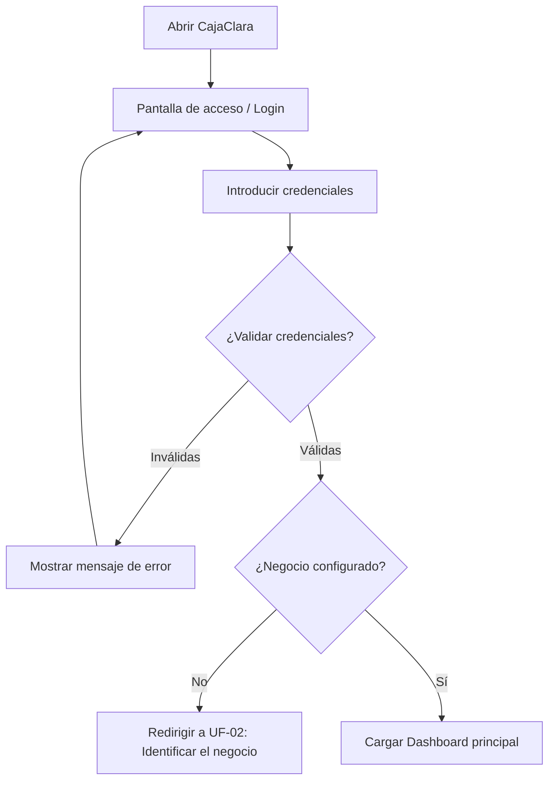

#### Resultado esperado
El usuario autenticado accede directamente a su panel principal de caja si su negocio ya está identificado, o es guiado a completar el nombre de su negocio si ingresa por primera vez.

#### Pantallas relacionadas
- `login.html` (o vista de autenticación)
- `dashboard.html`

#### Dependencias o decisiones pendientes
- Autenticación estándar basada en sesiones de Django.

---

### UF-02 Identificar el negocio

#### Objetivo
Permitir al comerciante registrar o actualizar el nombre comercial de su micronegocio (ej. *Almacén La Esquina*) para personalizar el encabezado y comprobantes de la aplicación.

#### Diagrama Mermaid
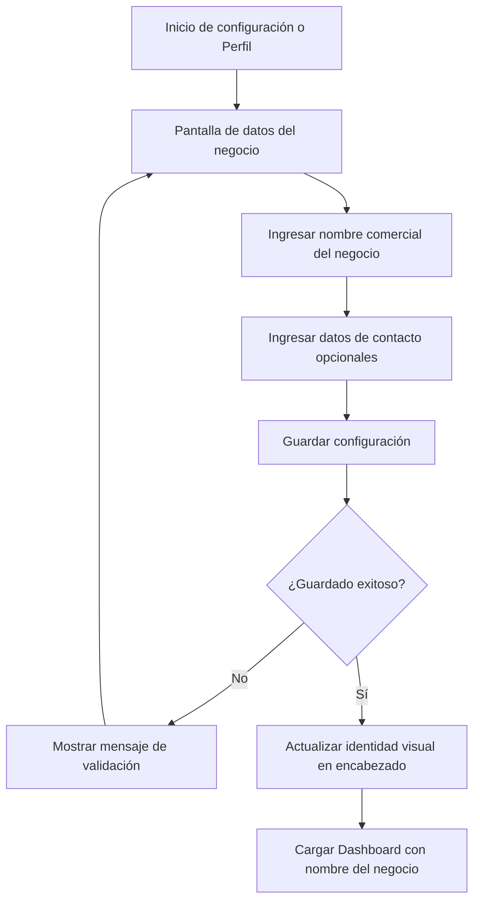

#### Resultado esperado
El nombre comercial queda guardado y se presenta de forma visible en el encabezado global de todas las pantallas (`dashboard.html`, `movimientos.html`, `cuentas-cobrar.html`).

#### Pantallas relacionadas
- Formulario de configuración de negocio / Perfil
- Encabezado global (`.header .user__meta`) en todos los wireframes

---

## Épica 2: Estado financiero

### UF-03 Consultar el estado financiero

#### Objetivo
Ofrecer al comerciante una visión inmediata, clara y libre de tecnicismos contables sobre la salud financiera de su caja en el periodo actual.

#### Diagrama Mermaid
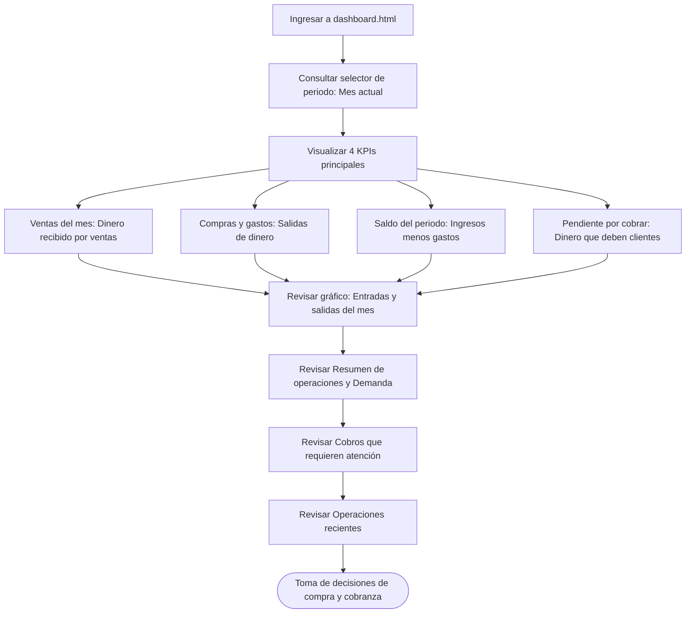

#### Resultado esperado
El usuario comprende en menos de 5 segundos cuánto dinero tiene disponible en caja, cuánto dinero ha ingresado y cuánto dinero tiene retenido en clientes que aún no le pagan.

#### Pantallas relacionadas
- `dashboard.html`

#### Dependencias o decisiones pendientes
- `TODO BACKEND`: Ventas = suma de movimientos de tipo INGRESO en el mes.
- `TODO BACKEND`: Compras y gastos = suma de movimientos de tipo GASTO en el mes.
- `TODO BACKEND`: Saldo = ingresos menos gastos. Regla de negocio: **no** utilizar conceptos como *Ganancia neta* ni *Margen bruto*.
- `TODO BACKEND`: Pendiente por cobrar = suma de cuentas en estado `PENDIENTE` y `VENCIDA`.

---

### UF-04 Revisar el resumen mensual

#### Objetivo
Permitir al comerciante inspeccionar el informe consolidado de movimientos, compras y cobros al cierre del mes o navegar entre meses anteriores.

#### Diagrama Mermaid
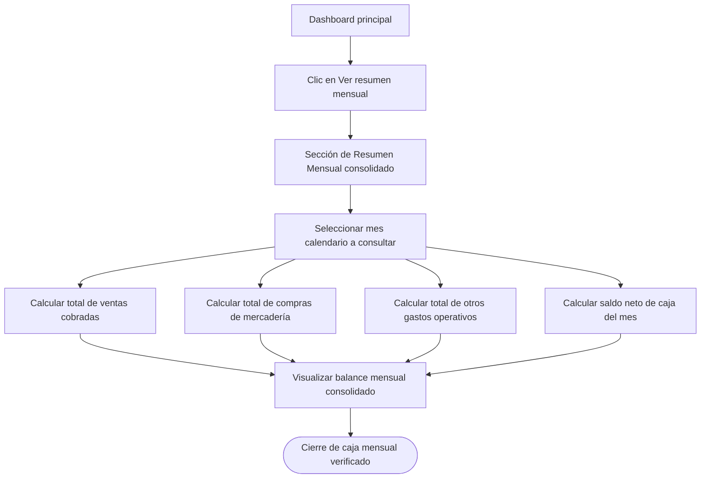

#### Resultado esperado
El usuario valida el comportamiento financiero del mes cerrado sin recurrir a planillas externas ni cálculos manuales.

#### Pantallas relacionadas
- `dashboard.html` (`#resumen-mensual`)

#### Dependencias o decisiones pendientes
- `TODO BACKEND`: Definir si el resumen mensual incluirá exportación simple para impresión o si se mantendrá como vista resumida en pantalla.

---

## Épica 3: Operaciones de caja

### UF-05 Registrar una venta pagada

#### Objetivo
Registrar una venta de productos al por menor donde el cliente realiza el pago completo de forma inmediata (efectivo, débito o transferencia).

#### Diagrama Mermaid
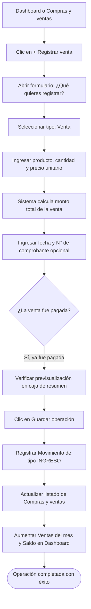

#### Resultado esperado
La venta queda guardada como movimiento de INGRESO con estado "Venta pagada", incrementando el saldo de caja y el acumulado de ventas del mes.

#### Pantallas relacionadas
- `dashboard.html`
- `movimientos.html?tipo=venta`
- Modal `#sheet-nuevo` en `movimientos.html`

#### Dependencias o decisiones pendientes
- `TODO BACKEND`: Confirmar producto, cantidad y precio unitario en el modelo de operaciones (actualmente `Movimiento` solo contempla monto, fecha, categoría y descripción).

---

### UF-06 Registrar una venta pendiente

#### Objetivo
Registrar la venta de productos cuando el cliente se lleva la mercadería pero pagará en una fecha posterior (crédito/fiado), registrando los datos necesarios para su cobranza.

#### Diagrama Mermaid
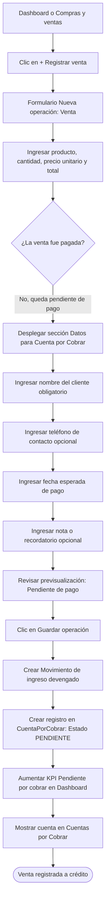

#### Resultado esperado
La operación queda anotada como venta pendiente, no infla el saldo de caja disponible hasta que se cobre, y aparece de inmediato en el módulo de Cuentas por Cobrar.

#### Pantallas relacionadas
- `dashboard.html`
- `movimientos.html?tipo=venta`
- `cuentas-cobrar.html`

#### Dependencias o decisiones pendientes
- `TODO BACKEND`: Confirmar creación conjunta y atómica del `Movimiento` de ingreso y la instancia `CuentaPorCobrar`.

---

### UF-07 Registrar una compra

#### Objetivo
Registrar la compra de mercadería al por mayor (cajas, paquetes o fardos de productos) destinada a la reventa, como una salida de dinero en la caja.

#### Diagrama Mermaid
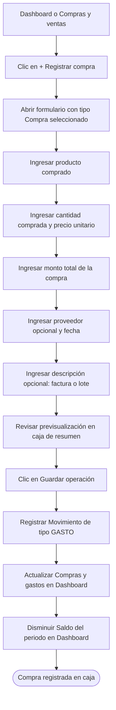

#### Resultado esperado
La compra se registra como salida de dinero sin prometer inventario automático, disminuyendo el saldo de caja del periodo.

#### Pantallas relacionadas
- `dashboard.html`
- `movimientos.html?tipo=compra`
- Modal `#sheet-nuevo` en `movimientos.html`

#### Dependencias o decisiones pendientes
- `TODO BACKEND`: Proveedor y detalle del producto no pertenecen al modelo confirmado de `Movimiento`.

---

### UF-08 Registrar otro gasto

#### Objetivo
Registrar salidas de dinero operativas de la caja que no corresponden a compra de mercadería (ej. transporte/fletes, arriendos, insumos de embalaje o servicios).

#### Diagrama Mermaid
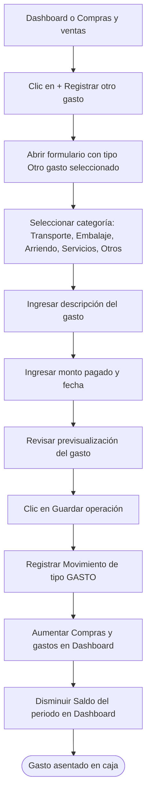

#### Resultado esperado
El gasto operativo queda categorizado y registrado, manteniendo el saldo de caja cuadrado con el dinero real disponible.

#### Pantallas relacionadas
- `dashboard.html`
- `movimientos.html?tipo=gasto`
- Modal `#sheet-nuevo` en `movimientos.html`

#### Dependencias o decisiones pendientes
- Estandarización de las categorías de gasto en los fixtures o tablas maestras de Django.

---

## Épica 4: Cobranza

### UF-09 Consultar cuentas por cobrar

#### Objetivo
Permitir al comerciante supervisar todo el dinero que le deben sus clientes, revisar vencimientos próximos o vencidos y acceder a acciones directas de gestión.

#### Diagrama Mermaid
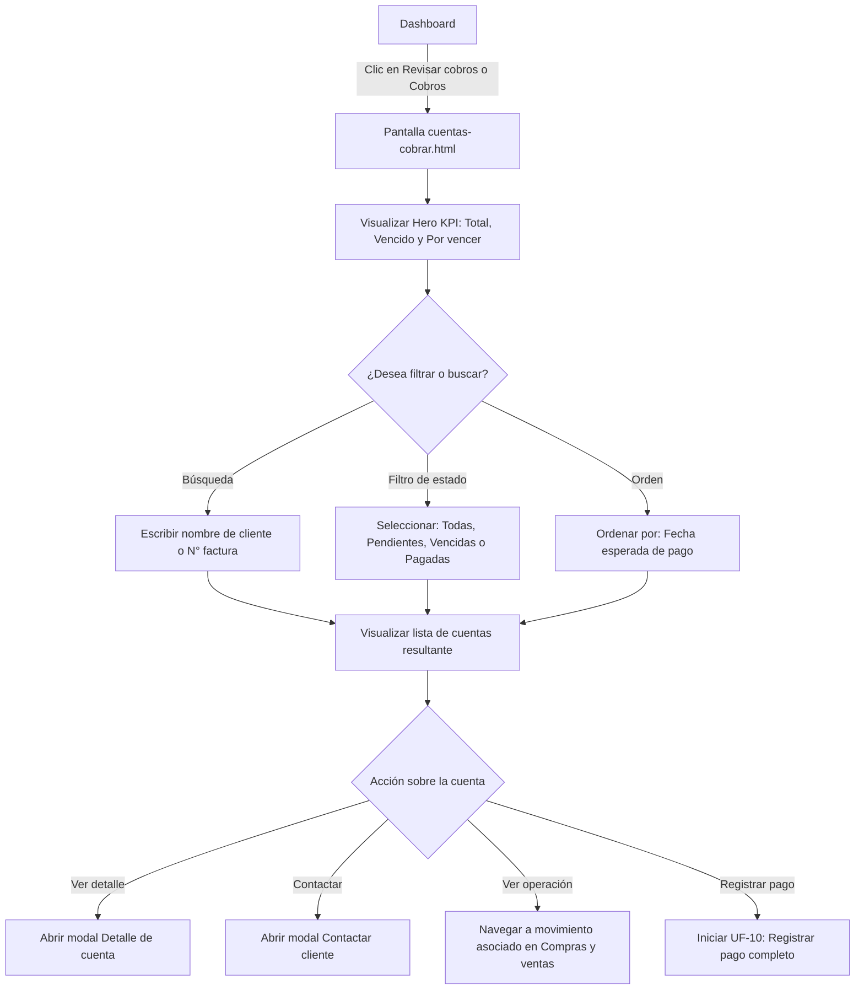

#### Resultado esperado
El comerciante visualiza claramente a quién debe cobrarle con prioridad (cuentas vencidas y próximas a vencer) con accesos de un solo clic.

#### Pantallas relacionadas
- `dashboard.html`
- `cuentas-cobrar.html`
- Modales `#sheet-detalle-cuenta` y `#sheet-contactar`

#### Dependencias o decisiones pendientes
- `TODO FRONTEND/BACKEND`: Las opciones de contacto (ver teléfono, copiar mensaje, copiar datos bancarios) son simulaciones del prototipo sin integraciones a APIs externas.

---

### UF-10 Registrar pago completo

#### Objetivo
Registrar el cobro total de una deuda cuando el cliente entrega el dinero pendiente, actualizando el estado de la cuenta a `PAGADA`.

#### Diagrama Mermaid
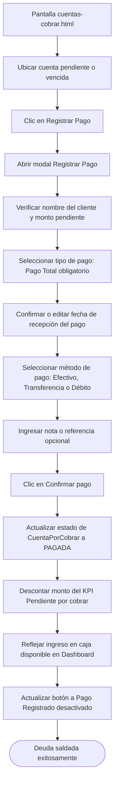

#### Resultado esperado
La cuenta pasa al estado `PAGADA`, el monto se resta del total pendiente por cobrar del negocio y se actualiza el dinero recibido en la caja.

#### Pantallas relacionadas
- `cuentas-cobrar.html`
- Modal `#sheet-pago` en `cuentas-cobrar.html`
- `dashboard.html` (indicador de cobros actualizado)

#### Dependencias o decisiones pendientes
- `TODO BACKEND`: Confirmar si el MVP permitirá pagos parciales o si se restringe exclusivamente a pagos completos para simplificar la primera versión.

---

## Mapa general de navegación

El siguiente mapa describe el flujo de navegación entre las pantallas de la aplicación, reflejando fielmente la estructura de los wireframes:

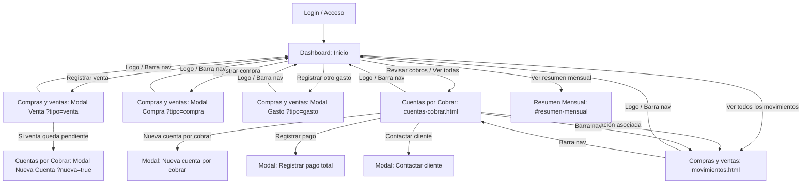

---

## Pantallas relacionadas

| Identificador | Archivo Wireframe | User Flows Asociados | Rol en la Experiencia de Usuario |
| :--- | :--- | :--- | :--- |
| **Inicio / Acceso** | `login.html` *(prevista)* | UF-01, UF-02 | Autenticación del usuario y verificación de configuración del negocio. |
| **Panel Principal** | [`ux/wireframes/dashboard.html`](file:///c:/Users/jorge/OneDrive/Documentos/Portafolio/Proyecto%20Colaborativo%20TD/td_cajaclara/ux/wireframes/dashboard.html) | UF-01, UF-02, UF-03, UF-04 | Centro de control de la caja: KPIs financieros, gráfico de entradas/salidas, resumen de operaciones, cobros urgentes y acciones rápidas. |
| **Compras y Ventas** | [`ux/wireframes/movimientos.html`](file:///c:/Users/jorge/OneDrive/Documentos/Portafolio/Proyecto%20Colaborativo%20TD/td_cajaclara/ux/wireframes/movimientos.html) | UF-05, UF-06, UF-07, UF-08 | Libro de caja de entradas y salidas. Incluye buscador, filtros y formulario universal modal para venta, compra y gasto. |
| **Cuentas por Cobrar** | [`ux/wireframes/cuentas-cobrar.html`](file:///c:/Users/jorge/OneDrive/Documentos/Portafolio/Proyecto%20Colaborativo%20TD/td_cajaclara/ux/wireframes/cuentas-cobrar.html) | UF-06, UF-09, UF-10 | Módulo de cobranzas a clientes fiados. Hero KPI, filtros por estado, orden por vencimiento, registro de pago total y simulación de contacto. |
| **Resumen Mensual** | `dashboard.html#resumen-mensual` | UF-04 | Vista de consolidación financiera mensual para cierres de caja. |

---

## Decisiones pendientes de Backend

Para asegurar la transición exitosa de wireframes a prototipo funcional e integración Django, se documentan las siguientes definiciones pendientes:

1. **Creación atómica de Venta a Crédito $\leftrightarrow$ Cuenta por Cobrar:**
   - `TODO BACKEND`: Confirmar si al guardar una venta no pagada en `movimientos.html`, el backend generará automáticamente la instancia de `CuentaPorCobrar` en una sola transacción (`transaction.atomic`).
2. **Campos comerciales en el modelo `Movimiento`:**
   - `TODO BACKEND`: Confirmar si se incorporarán formalmente los campos `producto`, `cantidad` y `precio_unitario` al modelo `Movimiento` o si temporalmente se almacenarán estructurados en el campo `descripcion`.
3. **Detalle de compras y proveedores:**
   - `TODO BACKEND`: Confirmar si el modelo de compras registrará la entidad `Proveedor` y detalle unitario de bulto/caja en el MVP.
4. **Política de pagos:**
   - `TODO BACKEND`: Confirmar que el MVP solo contemplará **pago total** de cuentas por cobrar para mantener la simplicidad operativa de la caja registradora.
5. **Cálculo de estados y alertas temporales:**
   - `TODO BACKEND`: Definir el umbral formal para la alerta calculada *"Vence en X días"* (propuesta de UX: $\le 7$ días antes del vencimiento).

---

## Alcance del MVP

### Funcionalidades Incluidas en el MVP
- Identificación visible del negocio en el encabezado.
- Dashboard con 4 KPIs de caja: Ventas del mes, Compras y gastos, Saldo del periodo y Pendiente por cobrar.
- Gráfico comparativo de entradas y salidas por semana en escala de grises.
- Registro ágil de ventas pagadas por unidad.
- Registro de ventas a crédito con asignación de cliente y fecha de vencimiento.
- Registro de compras de mercadería al por mayor (salida de dinero).
- Registro de otros gastos operativos (transporte, arriendo, servicios, etc.).
- Filtros por tipo de operación y buscador en Compras y ventas.
- Módulo de Cuentas por Cobrar con estados `PENDIENTE`, `VENCIDA` y `PAGADA`.
- Registro de pago completo de cuentas por cobrar.
- Conectividad fluida entre pantallas mediante parámetros URL (`?tipo=venta`, `?tipo=compra`, `?tipo=gasto`, `?nueva=true`).

### Funcionalidades Excluidas del MVP (Futuras iteraciones)
- Descuento automático de stock e inventario en tiempo real.
- Informes de rentabilidad, margen bruto o ganancia neta contable.
- Pagos parciales o gestión de abonos complejos.
- Integración real con APIs de mensajería (WhatsApp Business API), pasarelas de pago o discadores telefónicos.
- Generación de libros contables oficiales o facturación electrónica ante entidades tributarias.

---

## Responsable

- **Rol:** UX Designer Senior & Frontend Prototyper
- **Proyecto:** CajaClara
- **Proyecto Colaborativo:** Talento Digital para Chile
- **Año:** 2026
