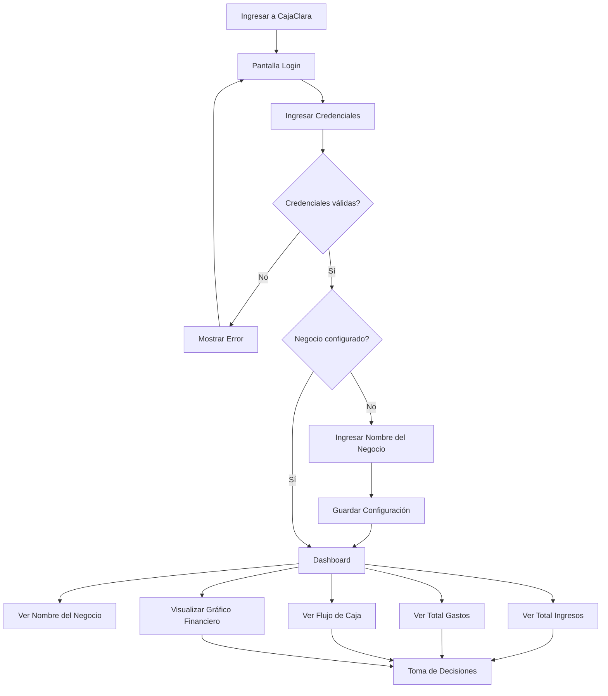
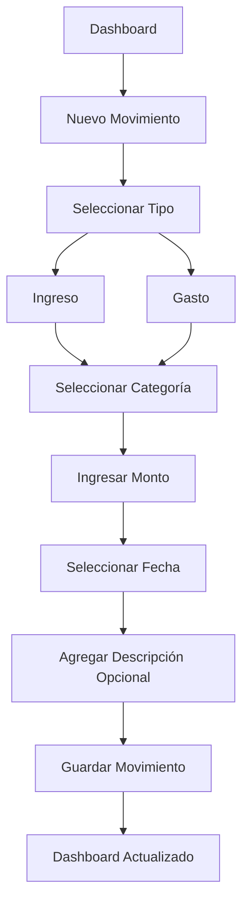
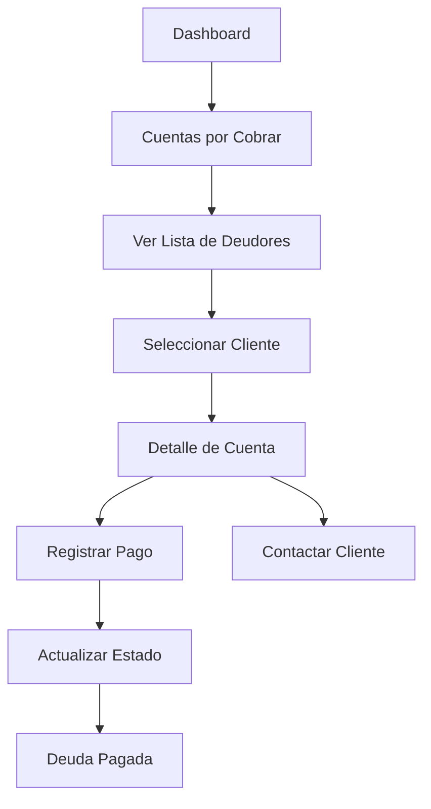
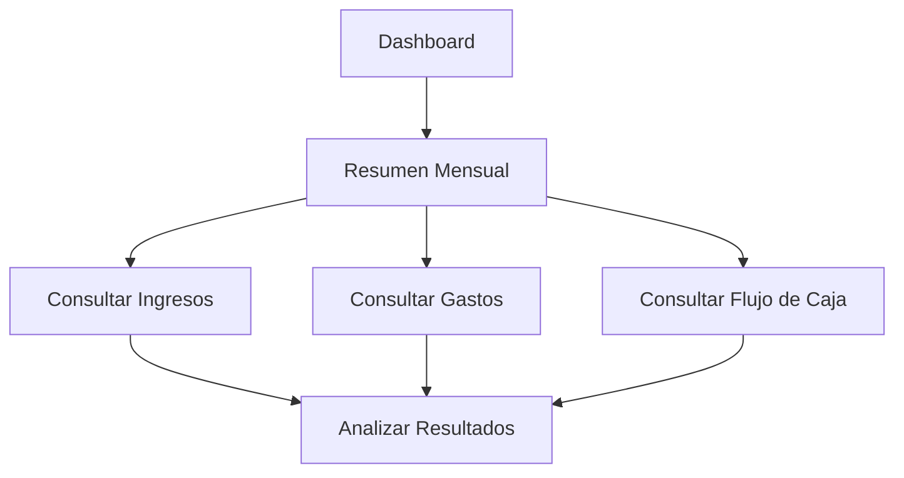
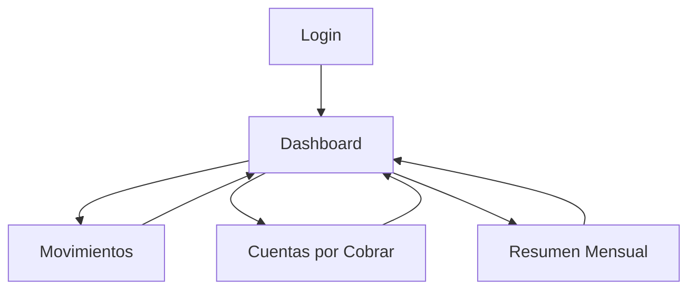

# User Flows - CajaClara

## Proyecto

CajaClara es una plataforma de gestión financiera para emprendedores y pequeñas empresas que permite controlar ingresos, gastos, flujo de caja y cuentas por cobrar.

---

# User Flow 1: Acceder a CajaClara y Consultar Estado Financiero

## Objetivo

Permitir que el usuario acceda a su cuenta de forma segura y visualice rápidamente la situación financiera de su negocio.

### Resultado esperado

El usuario accede de forma segura a la aplicación y comprende rápidamente el estado financiero de su negocio.

---

# User Flow 2: Registrar Movimiento

## Objetivo

Permitir registrar ingresos y gastos de forma rápida y sencilla.

### Resultado esperado

El movimiento queda registrado y los indicadores financieros se actualizan automáticamente.

---

# User Flow 3: Gestionar Cuenta por Cobrar

## Objetivo

Permitir gestionar pagos pendientes de clientes.

### Resultado esperado

El usuario puede realizar seguimiento de clientes con pagos pendientes y actualizar el estado de sus deudas.

---

# User Flow 4: Revisar Resumen Mensual

## Objetivo

Permitir analizar el rendimiento financiero mensual del negocio.

### Resultado esperado

El usuario obtiene una visión consolidada del desempeño financiero del período.

---

# User Flow General del MVP

## Objetivo

Representar el recorrido principal del usuario dentro de CajaClara.

### Resultado esperado

El usuario puede navegar entre las funcionalidades principales del sistema desde el Dashboard.

---

# Pantallas Relacionadas

| Pantalla | User Flow |
|-----------|------------|
| Login | Acceder a CajaClara y Consultar Estado Financiero |
| Configuración Negocio | Acceder a CajaClara y Consultar Estado Financiero |
| Dashboard | Acceder a CajaClara y Consultar Estado Financiero |
| Movimientos | Registrar Movimiento |
| Cuentas por Cobrar | Gestionar Cuenta por Cobrar |
| Detalle Deudor | Gestionar Cuenta por Cobrar |
| Resumen Mensual | Revisar Resumen Mensual |

---

# Alcance MVP

Las funcionalidades consideradas para el MVP son:

- Inicio de sesión
- Configuración del negocio
- Dashboard financiero
- Registro de ingresos
- Registro de gastos
- Cuentas por cobrar
- Gestión de deudores
- Resumen mensual
- Flujo de caja

---

# Responsable

UX Designer: Jorge Tamayo

Proyecto: CajaClara

Proyecto Colaborativo Talento Digital

https://colaboratd.cl/

Año: 2026